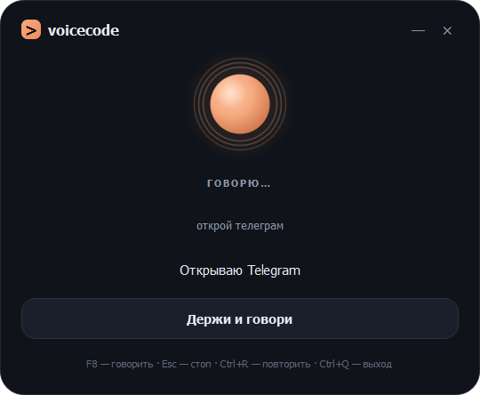

# VoiceCode для Arch Linux

Голосовая мини-копия [opencode](https://opencode.ai): зажимаешь клавишу, говоришь по-русски, отпускаешь — и слышишь ответ. Без чата и истории на экране: только статус, распознанная фраза, строка ответа и анимированный орб в стиле opencode.

Это независимый Linux-порт по описанию из [README оригинального VoiceCode](https://github.com/Tweendobr1/VoiceCode). В том репозитории опубликованы только README и скриншот, исходного кода Windows-версии нет, поэтому весь код здесь написан заново под Wayland/X11 и Arch Linux.



## Что умеет

- **Push-to-talk.** `F8` глобально (через `evdev`) или `Space` в окне. Микрофонный поток PortAudio открыт постоянно, запись начинается мгновенно.
- **Локальное распознавание.** `faster-whisper small` в `int8` на CPU. Модель можно скачать заранее или при первом запуске с Hugging Face.
- **Голосовой ответ.** `edge-tts` (`ru-RU-DmitryNeural`) с озвучкой по предложениям; если Microsoft недоступен — офлайн-синтез: `piper`, иначе `espeak-ng`.
- **Системные команды.** Открывает программы и сайты, ищет в интернете, делает скриншот, управляет громкостью, блокирует сеанс, сворачивает/закрывает/переключает окна, подсказывает время и дату — всё локально.
- **Всё остальное — в opencode.** Вопросы, код и объяснения уходят в `opencode run`; ответ приходит потоком и сразу озвучивается.
- **Трей и один экземпляр.** Закрытие окна сворачивает в трей, второй запуск блокируется через `flock`.

```
F8 / Space / кнопка
        │  (микрофон уже открыт)
        ▼
faster-whisper small → текст
        │
        ├─ локальный роутер команд → действие + короткая фраза
        │
        └─ opencode run --format json → поток текста
                                            │
                                            ▼
                                 edge-tts / piper / espeak по предложениям
```

## Требования

- Arch Linux (или совместимый дистрибутив с `pacman`), Wayland или X11.
- Микрофон и динамики/наушники.
- Python 3.10+ (в Arch сейчас 3.12/3.13).
- Для сборки из исходников: `python`, `portaudio`, `ffmpeg`, `espeak-ng`, `xdg-utils`, `libnotify`, `procps-ng`.

## Установка

### 1. Скрипт (рекомендуется)

```bash
git clone <этот-репозиторий> voicecode-linux
cd voicecode-linux
bash install.sh
```

Скрипт:

1. ставит пакеты из официальных репозиториев (`python`, `portaudio`, `ffmpeg`, `espeak-ng`, `python-evdev`, `grim`, `xdotool`, …);
2. создаёт `.venv` с `--system-site-packages` и ставит Python-зависимости;
3. скачивает `faster-whisper-small` в `models/` (можно пропустить: `--skip-model`);
4. добавляет ярлык в меню и иконку.

Полезные флаги: `--skip-deps`, `--skip-model`, `--autostart`.

### 2. Пакет Arch (PKGBUILD)

```bash
cd packaging
makepkg -si
```

Зависимости `python-faster-whisper` и `python-edge-tts` живут в AUR, поэтому удобнее собирать через AUR-хелпер (`yay -S --needed python-faster-whisper python-edge-tts`, затем `makepkg -si`) или сначала поставить их вручную.

Пакет кладёт код в `/opt/voicecode`, ярлык — в `/usr/share/applications`, конфиг — в `/usr/share/voicecode/config.json`. При первом запуске он копируется в `~/.config/voicecode/config.json`; там его и правь. Модель для системной установки скачивается в `~/.local/share/voicecode/models`.

### 3. Вручную

```bash
sudo pacman -S --needed python pyside6 python-numpy python-av python-evdev portaudio ffmpeg espeak-ng xdg-utils libnotify procps-ng grim xdotool
python -m venv --system-site-packages .venv
.venv/bin/python -m pip install -r requirements.txt
.venv/bin/python tools/fetch_model.py --size small
bash run.sh --debug
```

### Глобальная клавиша на Wayland

`evdev` читает `/dev/input/event*`, а туда обычному пользователю доступа нет. Один раз:

```bash
sudo usermod -aG input "$USER"
```

После этого **перезайди в сессию** (или перезагрузись). Проверка — `python tools/warmup.py`: строка `evdev` должна быть зелёной.

На X11, если `evdev` недоступен, автоматически используется `pynput`, и группа `input` не нужна. В окне всегда работает `Space`, даже без прав.

## Запуск

```bash
bash run.sh          # обычный запуск
bash run-debug.sh    # с подробным логом в консоли
```

Проверка голоса без интерфейса:

```bash
bash run.sh --say "Проверка голоса"
```

Приложение сворачивается в трей; полностью закрывается через `Ctrl+Q`, меню трея или «Выход».

Опционально — автозапуск через systemd:

```bash
mkdir -p ~/.config/systemd/user
cp packaging/voicecode.service ~/.config/systemd/user/
# для системной установки: systemctl --user enable --now voicecode
```

Для source-установки поменяй в юните `ExecStart` на абсолютный путь к `run.sh`.

## Управление

| Что | Как |
| --- | --- |
| Говорить | зажать `F8` в любой программе, `Space` в окне или кнопку «Держи и говори» |
| Отменить ответ / остановить озвучку | `Esc`, новая фраза или слово «стоп» |
| Повторить последний ответ | `Ctrl+R` или «повтори» |
| Свернуть в трей | кнопка «—», закрытие окна или «скройся» |
| Выход | `Ctrl+Q`, меню трея или «выключись» |
| Перетащить окно | потянуть за карточку |

## Голосовые команды

Всё, что не совпало с локальной командой, уходит в opencode.

| Скажи | Что будет |
| --- | --- |
| «открой телеграм», «запусти калькулятор», «вруби блокнот» | запуск приложения из `.desktop` |
| «открой ютуб», «открой сайт гитхаб», «открой github.com» | сайт в браузере |
| «найди в интернете погоду на завтра», «погугли новости» | поиск в браузере |
| «который час», «какое сегодня число» | время и дата |
| «сделай скриншот» | снимок экрана в `~/Pictures` |
| «громче», «тише», «выключи звук», «включи звук» | громкость через `wpctl`/`pamixer`/`amixer` |
| «сверни окно», «покажи рабочий стол» | свернуть активное окно / показать рабочий стол |
| «закрой окно», «переключи окно» | закрыть активное окно / следующее окно |
| «закрой телеграм» | закрыть приложение (`pkill`/`flatpak kill`) |
| «заблокируй компьютер» | `loginctl lock-session` или локер |
| «скройся» | свернуть в трей |
| «выключись» | выход из VoiceCode |
| «повтори», «стоп», «спасибо», «что ты умеешь» | служебные фразы |

Роутер понимает «пожалуйста», «слушай», «можешь» и другие вежливые вставки. Посмотреть решения на наборе фраз:

```bash
.venv/bin/python tools/route_check.py
```

## Поддержка окружений

| Действие | Hyprland | Sway | KDE Plasma (Wayland) | GNOME Wayland | X11 |
| --- | --- | --- | --- | --- | --- |
| Громкость | `wpctl` | `wpctl` | `wpctl` | `wpctl` | `wpctl`/`pamixer` |
| Скриншот | `grim` | `grim` | `spectacle` | `grim`/`gnome-screenshot` | `scrot`/`maim` |
| Свернуть окно | `hyprctl` | `scratchpad` | ярлык KWin | — | `xdotool` |
| Закрыть окно | `hyprctl killactive` | `swaymsg kill` | ярлык KWin | — | `xdotool` |
| Переключить окно | `cyclenext` | `focus next` | KWin | `wtype`/— | `Alt+Tab` |
| Рабочий стол | special workspace | workspace | ярлык KWin | — | `Super+D` |
| Блокировка | `loginctl`/`hyprlock` | `swaylock` | `loginctl` | `loginctl` | `loginctl` |

Композитор определяется автоматически. Можно задать вручную: `"compositor": "hyprland" | "sway" | "kde" | "gnome" | "x11" | "auto"`.

Ограничения Wayland честные: универсального API для управления чужими окнами нет, поэтому для GNOME часть команд окон недоступна, а в KDE используются глобальные ярлыки KWin. `xdotool` на Wayland работает только с XWayland-окнами.

## Настройка

Все параметры — в `config.json` рядом с `main.py` (для пакета — `~/.config/voicecode/config.json`). Файл читается при запуске.

| Параметр | По умолчанию | Что делает |
| --- | --- | --- |
| `language` | `"ru"` | язык распознавания; `"auto"` — автоопределение |
| `whisper_model` | `"models/faster-whisper-small"` | путь к модели или имя HF (`"small"`, `"base"`, `"medium"`) |
| `whisper_compute` | `"int8"` | тип вычислений CTranslate2 |
| `whisper_threads` | `0` | потоки CPU; `0` — все ядра минус два |
| `tts_engine` | `"edge"` | `"edge"`, `"system"` (офлайн) или `"auto"` |
| `voice` | `"ru-RU-DmitryNeural"` | голос edge-tts (`ru-RU-SvetlanaNeural`, `ru-RU-DariyaNeural`) |
| `tts_rate` | `"+8%"` | скорость речи |
| `tts_volume` | `"+0%"` | громкость edge-tts |
| `system_tts` | `"auto"` | офлайн-движок: `auto`, `piper`, `espeak` |
| `piper_model` | `""` | путь к `.onnx`-голосу piper |
| `edge_check` | `true` | проверять доступность Microsoft при старте (2 с) |
| `opencode_cli` | `""` | путь к CLI, если автопоиск не сработал |
| `model` | `"opencode/deepseek-v4.1-flash-free"` | модель opencode |
| `agent` | `"build"` | агент opencode |
| `workspace` | `"agent"` | рабочая папка opencode (относительно проекта) |
| `auto_approve` | `false` | добавляет `--auto` |
| `keep_context` | `true` | подмешивать последние реплики в промпт |
| `max_context_turns` | `6` | сколько пар «вопрос-ответ» помнить |
| `timeout_sec` | `150` | предел ожидания opencode |
| `microphone` | `""` | имя микрофона; `""` — устройство по умолчанию |
| `sample_rate` | `16000` | частота записи |
| `max_record_sec` | `30` | максимум записи на одну фразу |
| `global_hotkey` | `"f8"` | глобальная клавиша (`f1`–`f12`, `scrolllock`, `pause`, …) |
| `hotkey_grab` | `false` | захватывать устройство через `evdev.grab`; не включай без необходимости — клавиатура станет эксклюзивной |
| `compositor` | `"auto"` | `hyprland`, `sway`, `kde`, `gnome`, `x11`, `auto` |
| `greeting` | `true` | здороваться голосом после загрузки |
| `minimize_to_tray` | `true` | закрытие окна сворачивает в трей |
| `start_minimized` | `false` | стартовать сразу в трее |
| `search_url` | Яндекс | шаблон поиска, `{query}` подставляется |
| `show_caption` | `true` | показывать распознанную строку |
| `volume_step` | `5` | шаг громкости в процентах |
| `screenshot_dir` | `""` | папка скриншотов; `""` — XDG Pictures |
| `notifications` | `true` | уведомления `notify-send` |
| `log_level` | `"INFO"` | уровень лога |

Пример для слабого ноутбука:

```json
{
  "whisper_threads": 4,
  "tts_engine": "system",
  "system_tts": "espeak",
  "model": "opencode/deepseek-v4.1-flash-free"
}
```

### Модель распознавания

```bash
.venv/bin/python tools/fetch_model.py --size small     # ~250 МБ, int8
.venv/bin/python tools/fetch_model.py --size base      # быстрее, менее точно
```

Можно не хранить модель локально: поставь `"whisper_model": "small"` — faster-whisper скачает её сам при первом запуске.

### Голос

`edge-tts` звучит живее, но требует доступ к `speech.platform.bing.com`. При старте VoiceCode один раз проверяет доступность и при неудаче сразу переключается на офлайн-синтез.

Полностью офлайн:

```json
{ "tts_engine": "system" }
```

Для `piper` установи `piper-tts` (AUR), скачай русский голос и укажи путь:

```json
{
  "tts_engine": "system",
  "system_tts": "piper",
  "piper_model": "~/.local/share/piper/ru_RU-dmitri-medium.onnx"
}
```

Без `piper` используется `espeak-ng -v ru` — разборчиво, но роботизированно.

### opencode

VoiceCode ищет CLI в таком порядке: `opencode_cli` из конфига → `opencode-cli` и `opencode` в `PATH` → `~/.opencode/bin/opencode` → `~/.local/bin/opencode` → `/usr/local/bin` → `/usr/bin` → `/opt/opencode`.

Вызов:

```bash
opencode run --format json --model <model> --agent <agent> [--auto] "<промпт>"
```

Если версия CLI не понимает `--format json`, VoiceCode автоматически повторяет вызов без него и разбирает обычный текст. Контекст диалога собирается локально в промпт; `--session`/`--continue` не используются.

Правила для модели лежат в `agent/AGENTS.md`: отвечать по-русски, коротко, без markdown и кода, потому что ответ читают вслух.

## Приватность

- Запись микрофона живёт только в памяти и никуда не сохраняется.
- Распознавание и локальные команды выполняются на компьютере.
- В opencode уходит только распознанный текст (и последние реплики при `keep_context`). Куда именно — зависит от провайдера opencode.
- В `~/.local/state/voicecode/logs/voicecode.log` попадают распознанные фразы и служебные события; файл ротируется.

## Диагностика

```bash
.venv/bin/python tools/warmup.py       # окружение, модель, микрофоны, команды, хоткей
.venv/bin/python tools/route_check.py  # какие фразы уходят в opencode
```

Лог: `~/.local/state/voicecode/logs/voicecode.log` (для пакета — там же).

### Если что-то не работает

| Симптом | Что делать |
| --- | --- |
| `F8` не реагирует на Wayland | добавь пользователя в группу `input` и перезайди; проверь `warmup.py` |
| `F8` не реагирует на X11 | закрой программы, перехватывающие клавишу; проверь `pynput`; смени `global_hotkey` |
| «Не нашёл opencode» | укажи путь в `opencode_cli`; проверь `opencode --version` |
| «Не удалось загрузить модель Whisper» | `tools/fetch_model.py` или `"whisper_model": "small"` |
| «Микрофон недоступен» | посмотри имя устройства в `warmup.py` и впиши в `microphone` |
| Ответ есть, звука нет | проверь `ffplay`/`mpv`, устройство вывода PipeWire; поставь `"tts_engine": "system"` |
| edge-tts молчит | это ожидаемо за прокси/файрволом — офлайн-синтез подхватится сам |
| Скриншот не делается | установи `grim` (Wayland) или `spectacle`/`flameshot`/`scrot` |
| «Не умею сворачивать окна» | Wayland-ограничение; для Hyprland/Sway/KDE команды поддерживаются |
| Окно не появляется | приложение уже в трее; второй экземпляр блокируется `.lock` |
| Долгий ответ | уменьши `max_context_turns`, смени модель, оставь `int8` |

## Структура проекта

```
voicecode-linux/
  main.py                     точка входа и аргументы CLI
  config.json                 настройки
  install.sh                  установка на Arch (pacman + venv)
  run.sh / run-debug.sh       запуск
  uninstall.sh                удаление ярлыков / окружения
  agent/AGENTS.md             правила для opencode
  packaging/                  PKGBUILD, .desktop, иконка, systemd-юнит
  tools/
    warmup.py                 диагностика окружения
    route_check.py            проверка локального роутера
    fetch_model.py            загрузка модели faster-whisper
  voicecode/
    app.py                    QApplication, блокировка второго экземпляра
    config.py, paths.py       настройки и XDG-пути
    stt.py                    faster-whisper
    opencode.py               поиск CLI, потоковый вызов, разбор JSON
    intents.py                русский роутер команд
    apps.py                   индекс .desktop, сайты, запуск и закрытие
    system.py                 Linux-действия (окна, звук, скриншоты, блокировка)
    hotkey.py                 evdev / pynput
    audio/recorder.py         постоянно открытый микрофон
    audio/speech.py           edge-tts + piper/espeak, очередь предложений
    ui/window.py              состояние, хоткеи, трей
    ui/widgets.py             логотип, орб, кнопка
    ui/theme.py               палитра opencode
```

## Отличия от Windows-версии и ограничения

- Вместо SAPI — `piper`/`espeak-ng`; вместо `keyboard` — `evdev`/`pynput`; вместо Win32-команд — `hyprctl`/`swaymsg`/KWin/`xdotool`/`wpctl`/`grim`.
- Установщика `.exe` и встроенного `opencode-cli` нет: opencode ставится отдельно, модель скачивается скриптом.
- Ответ opencode нельзя прервать на стороне сервера: новая фраза отменяет озвучку, игнорирует опоздавший ответ и завершает локальный процесс CLI.
- Озвучка читает только текст; markdown вычищается, но сложные ответы всё равно лучше просить коротко.
- Управление окнами на Wayland не универсально: работает то, что умеет конкретный композитор.
- Интерфейс и команды рассчитаны на русский язык.
